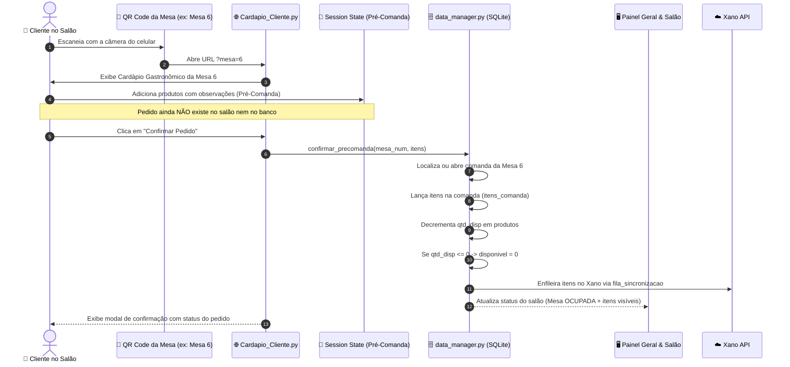

# Design Técnico: Cardápio Digital de Mesa via QR Code com Pré-Comanda do Cliente e Baixa Automática de Estoque

## 1. Arquitetura Geral & Fluxo de Dados



## 2. Componentes & Interfaces

### 2.1 Central de QR Codes (`pages/4_Mesas_QRCodes.py`)
- Lista todas as mesas cadastradas (ou intervalo padrão 1 a 10).
- Gera o QR Code vetorial/imagem utilizando `https://api.qrserver.com/v1/create-qr-code/?size=260x260&data={URL_ENC}` com fallback gráfico.
- Oferece pré-visualização, botão de teste ("Abrir Cardápio desta Mesa") e link de compartilhamento para copiar.

### 2.2 Cardápio do Cliente (`pages/5_Cardapio_Cliente.py`)
- Detecta o número da mesa via `st.query_params.get("mesa")`. Caso ausente, apresenta um seletor amigável para o cliente indicar em qual mesa está sentado.
- Interface limpa focada em experiência do cliente:
  - Header fixo com badge "Mesa X" e indicador de itens no carrinho.
  - Carrossel de categorias (Comidas, Carnes, Bebidas, Sobremesas).
  - Cards de produto com status de estoque (ex: badge verde "Disponível", ou vermelho "Esgotado"). Se esgotado, botão de adicionar fica desativado.
  - Barra inferior flutuante "Ver Pré-Comanda (X itens - R$ YY,YY)".
  - Diálogo modal `@st.dialog("🛒 Sua Pré-Comanda")`:
    - Listagem dos pratos selecionados.
    - Controles de quantidade `+` e `-`.
    - Campo de observação por prato (ex: "Sem pimenta").
    - Botão "🚀 Enviar Pedido para a Cozinha".

### 2.3 Regras de Estoque no `data_manager.py`
- Adicionar transação segura:
  ```python
  def decrementar_estoque_produto(cursor, produto_id: int, quantidade: int):
      cursor.execute("SELECT qtd_disp FROM produtos WHERE id = ?", (produto_id,))
      row = cursor.fetchone()
      if row:
          novo_saldo = max(0, (row["qtd_disp"] or 0) - quantidade)
          disponivel = 1 if novo_saldo > 0 else 0
          cursor.execute("""
              UPDATE produtos 
              SET qtd_disp = ?, disponivel = ? 
              WHERE id = ?
          """, (novo_saldo, disponivel, produto_id))
  ```
- Integrar essa baixa tanto em `adicionar_item_comanda` quanto no processamento da pré-comanda.
- Caso um item seja excluído da comanda (`remover_item_comanda`), devolver o saldo correspondente ao produto.

## 3. Segurança e Concorrência
- Evita race conditions utilizando `_db_lock` e transações SQLite atômicas.
- Sanitização rigorosa via `html.escape` nas observações enviadas pelo cliente.
