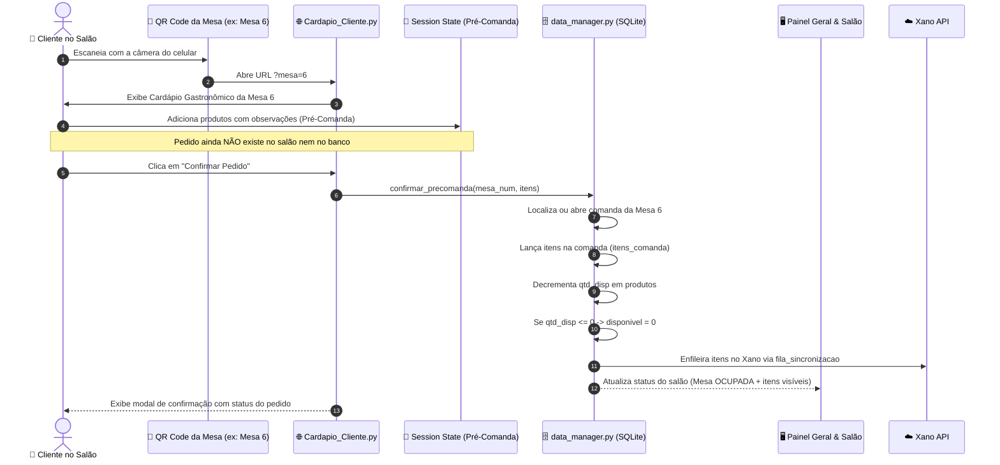

# Design Técnico: Cardápio Digital de Mesa via QR Code com Pré-Comanda do Cliente e Baixa Automática de Estoque

## 1. Arquitetura Geral & Fluxo de Dados



## 2. Componentes & Interfaces

### 2.1 Central de QR Codes (`pages/4_Mesas_QRCodes.py`)
- Lista todas as mesas cadastradas (ou intervalo padrão 1 a 10).
- Gera o QR Code vetorial/imagem utilizando `https://api.qrserver.com/v1/create-qr-code/?size=260x260&data={URL_ENC}` com fallback gráfico.
- Oferece pré-visualização, botão de teste ("Abrir Cardápio desta Mesa") e link de compartilhamento para copiar.
- **Sincronização Reativa via `@st.fragment(run_every=60)`**: Envelopa o painel de QR Codes e cartões em fragmento com auto-refresh nativo a cada 60s via WebSocket.
- **Timer Regressivo Visual no Cliente**: Componente `components.html` renderizando contador em tempo real que desce de 60s a 0s e reinicia suavemente em cada ciclo sem travar a interface.

### 2.2 Cardápio do Cliente (`pages/5_Cardapio_Cliente.py`)
- Detecta o número da mesa via `st.query_params.get("mesa")`. Caso ausente, apresenta um seletor amigável para o cliente indicar em qual mesa está sentado.
- Interface limpa focada em experiência do cliente:
  - Header fixo com badge "Mesa X" e indicador de itens no carrinho.
  - Carrossel de categorias (Comidas, Carnes, Bebidas, Sobremesas).
  - Cards de produto com status de estoque (ex: badge verde "Disponível", ou vermelho "Esgotado"). Se esgotado, botão de adicionar fica desativado.
  - **Botão Flutuante (FAB) de Pré-Comanda**: Renderizado com estilo CSS fixo (`position: fixed; bottom: 24px; right: 24px; z-index: 999999`) para acompanhar o scroll no mobile e permitir abertura do carrinho a qualquer momento.
  - Diálogo modal `@st.dialog("🛒 Sua Pré-Comanda")`:
    - Listagem dos pratos selecionados.
    - Controles de quantidade `+` e `-`.
    - Campo de observação por prato (ex: "Sem pimenta").
    - Botão "🚀 Enviar Pedido para a Cozinha".

### 2.3 Salão & Gestão de Comandas (`pages/1_Salao_e_Mesas.py`)
- **Painel Reativo com `@st.fragment(run_every=60)`**: Executa polling silencioso a cada 60s diretamente no SQLite local sem recarregar a janela (zero F5) e preservando o scroll do garçom/operador.
- **Controle Granular de Quantidade na Comanda**:
  - Botão `➖`: Subtrai 1 unidade, recalcula o subtotal e devolve 1 unidade ao estoque de `produtos`. Remove o item se a quantidade chegar a 0.
  - Botão `➕`: Adiciona 1 unidade, recalcula o subtotal e desconta 1 unidade do estoque atômico de `produtos`.
  - Botão `🗑️`: Exclui o item por completo e devolve todas as suas unidades ao estoque.

### 2.4 Regras de Estoque e Isolamento no `data_manager.py`
- Transação atômica de decremento:
  ```python
  def _decrementar_estoque_cursor(cursor, produto_id: int, quantidade: int):
      cursor.execute("SELECT qtd_disp FROM produtos WHERE id = ?", (produto_id,))
      p = cursor.fetchone()
      if p:
          saldo = p["qtd_disp"] if p["qtd_disp"] is not None else 15
          novo_saldo = max(0, saldo - quantidade)
          novo_disp = 1 if novo_saldo > 0 else 0
          cursor.execute("""
              UPDATE produtos 
              SET qtd_disp = ?, disponivel = ? 
              WHERE id = ?
          """, (novo_saldo, novo_disp, produto_id))
  ```
- Transação atômica de incremento/estorno:
  ```python
  def _incrementar_estoque_cursor(cursor, produto_id: int, quantidade: int):
      cursor.execute("SELECT qtd_disp FROM produtos WHERE id = ?", (produto_id,))
      p = cursor.fetchone()
      if p:
          saldo = p["qtd_disp"] if p["qtd_disp"] is not None else 0
          novo_saldo = saldo + quantidade
          novo_disp = 1 if novo_saldo > 0 else 0
          cursor.execute("""
              UPDATE produtos 
              SET qtd_disp = ?, disponivel = ? 
              WHERE id = ?
          """, (novo_saldo, novo_disp, produto_id))
  ```

## 3. Segurança, Concorrência e Proteção de Rate Limit
- **Zero Rate Limit**: Leituras periódicas são 100% locais no SQLite (`churrascontrol.db`), gastando 0 requisições HTTP externas do Xano.
- **Escrita Assíncrona Resiliente**: Operações de mutação usam a tabela `fila_sincronizacao`, mantendo o Xano atualizado sem travar o usuário.
- **Concorrência Protegida**: `_db_lock` e WAL mode garantem escrita sequencial sem locks fantasmas.
- **Sanitização contra XSS**: `html.escape` em todas as observações inseridas pelo cliente.
