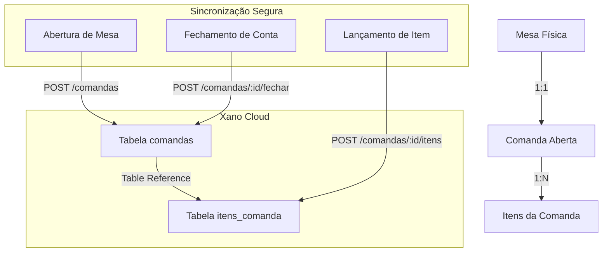

# Decisões de Design & Arquitetura — Sincronização de Comandas com Xano

## 1. Visão Geral da Arquitetura de Sincronização

A relação entre mesas, comandas e itens opera de forma hierárquica tanto no SQLite quanto no Xano:



---

## 2. Especificação do Novo Endpoint Xano (`POST /comandas`)

### Contrato da API (`comandas_POST.xs`):
- **Rota:** `/comandas`
- **Verbo:** `POST`
- **Entrada:**
  - `id`: integer (ID da comanda gerado no SQLite para paridade estrita)
  - `numero_mesa`: integer (número físico da mesa no salão)
  - `qtd_pessoas`: integer (padrão: 1)
- **Lógica no Xano:**
  1. Verifica se a comanda com o `id` já existe.
  2. Se não existir, executa `db.add comandas`:
     ```xs
     data = {
       id                   : $input.id,
       created_at           : "now",
       numero_mesa_historico: $input.numero_mesa,
       data_abertura        : "now",
       status               : "ABERTA",
       taxa_servico         : true,
       qtd_pessoas          : $input.qtd_pessoas,
       valor_total          : 0.00
     }
     ```
  3. Retorna `{ status: "ok", comanda_id: $input.id }`.

---

## 3. Mecanismo de Defesa & Auto-Recuperação em `comandas_itens_POST.xs`

Para resiliência contra condições de corrida (*race condition*) ou falhas transientes de rede onde o push de itens chega antes do push de abertura da comanda:
1. Ao receber `POST /comandas/{comanda_id}/itens`, o endpoint realiza um `db.get comandas { field_name: "id", field_value: $input.comanda_id }`.
2. Se `$comanda == null`:
   - Executa `db.add comandas` em tempo de execução com `status: "ABERTA"` e valores padrão seguros.
   - Prossegue imediatamente com a inserção em `itens_comanda`.
3. Resultado: A chave estrangeira `comanda_id` sempre encontra um registro válido correspondente, garantindo preenchimento visual e sem células vazias.

---

## 4. Modificações em `data_manager.py`

### 4.1. `abrir_mesa(numero_mesa, qtd_pessoas)`
Após o `conn.commit()` local no SQLite:
```python
_sync_push_imediato_ou_enfileirar("POST", "/comandas", {
    "id": nova_comanda_id,
    "numero_mesa": numero_mesa,
    "qtd_pessoas": qtd_pessoas
})
```

### 4.2. `confirmar_precomanda_cliente(numero_mesa, itens)`
Ao criar uma nova comanda para atendimento iniciado via QR Code:
```python
_sync_push_imediato_ou_enfileirar("POST", "/comandas", {
    "id": comanda_id,
    "numero_mesa": numero_mesa,
    "qtd_pessoas": 1
})
```

---

## 5. Estratégia de Fallback e Tratamento de Erros
- Caso o Xano esteja temporariamente indisponível ou em janela de rate limit (< 8 req / 20s), a chamada HTTP cai automaticamente na tabela SQLite `fila_sincronizacao`.
- A thread `_xano_sqlite_worker()` drena a fila respeitando a ordem cronológica estrita (`id ASC`), garantindo que a criação da comanda sempre seja processada no Xano antes dos itens vinculados a ela.
