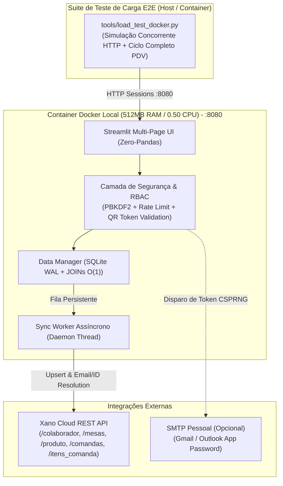

# Design Técnico — Blindagem de Segurança, Otimização de Performance, Paridade Total de Colaboradores no Xano e Ambiente Docker (512MB / 0.50 CPU)

## 1. Visão Geral da Arquitetura

---

## 2. Decisões Técnicas de Blindagem de Segurança (Seção 2 da Auditoria)

### 2.1 Externalização de Chaves Criptográficas e Remoção de Backdoors
- **Problema Atual**:
  - `backend/database/data_manager.py` possui `_FERNET_MASTER_KEY` e `CHURRAS_SALT` hardcoded no código-fonte.
  - `frontend/components/ui_components.py` exibe a chave mestre `'CHURRAS-REC-2026'` em texto claro na tela de login (`st.caption`), e `redefinir_senha_colaborador()` aceita códigos estáticos previsíveis (`CHURRAS-REC-2026`, `ADMIN-MASTER-KEY`, `GERENTE-AUTH-99`).
- **Solução Proposta**:
  - Ler `FERNET_MASTER_KEY` e `CHURRAS_SALT` de `os.environ` (carregados via `.env`).
  - Manter fallback de descriptografia legada (`_FERNET_LEGACY_CIPHER`) apenas em leitura para não corromper dados já gravados em `churrascontrol.db` ou no Xano, re-encriptando gradualmente com a chave de ambiente nas próximas escritas.
  - Remover completamente a exibição de códigos na UI (`ui_components.py`).
  - Substituir o fluxo de recuperação por:
    1. **Token Temporário CSPRNG** (`secrets.token_urlsafe(8)`) gerado com expiração de 15 minutos em tabela/colunas de controle ou enviado via **SMTP Pessoal** (`SMTP_HOST`, `SMTP_PORT`, `SMTP_USER`, `SMTP_APP_PASSWORD`) caso configurado no `.env`.
    2. **Fallback Offline Seguro**: Validação via variável de ambiente `ADMIN_RECOVERY_CODE` (nunca exposta no front-end) ou redefinição direta pelo Gerente autenticado na aba de Colaboradores.

### 2.2 Upgrade de Hash de Senha (`PBKDF2-HMAC-SHA256`) com Migração Transparente
- **Problema Atual**: `gerar_hash_senha()` utiliza apenas `hashlib.sha256(salted.encode()).hexdigest()` (1 iteração), vulnerável a ataques de força bruta por GPU.
- **Solução Proposta**:
  - Implementar `gerar_hash_senha(senha: str) -> str` utilizando `hashlib.pbkdf2_hmac('sha256', senha.encode(), salt, 100_000)` prefixado com `pbkdf2_sha256$100000$`.
  - Implementar `verificar_hash_senha(senha_plana: str, hash_armazenado: str) -> tuple[bool, bool]` que retorna `(valido, precisa_rehash)`.
  - Se `hash_armazenado` não possuir o prefixo `pbkdf2_sha256$`, valida contra o SHA-256 legado e, em caso de sucesso no `autenticar_colaborador()`, atualiza automaticamente o `senha_hash` no SQLite e enfileira `PATCH /colaborador/{id}` para o Xano.

### 2.3 Rate Limiting Anti-Brute-Force no Login e Recuperação
- **Problema Atual**: Inexistência de controle de tentativas de login por e-mail/sessão.
- **Solução Proposta**:
  - Adicionar controle em memória e SQLite (`login_attempts` / dicionário protegido por `threading.Lock`) limitando a **5 tentativas falhas consecutivas** na janela de **5 minutos** por e-mail, aplicando bloqueio temporário (cooldown de 60 segundos a 5 minutos) com mensagem clara na UI.

### 2.4 Validação Criptográfica do `token` no Cardápio Digital (`pages/5_Cardapio_Cliente.py`) e RBAC (`pages/4_Mesas_QRCodes.py`)
- **Problema Atual**:
  - `pages/5_Cardapio_Cliente.py` lê `mesa_id` da URL e ignora `st.query_params.get("token")`, permitindo enumeração trivial (`?mesa_id=1`, `?mesa_id=2`).
  - `seed_database()` gera tokens previsíveis (`f"mesa-{num}-token"`).
  - `pages/4_Mesas_QRCodes.py` não chama `verificar_permissao_acesso(["gerente", "caixa"])`.
- **Solução Proposta**:
  - Criar função `validar_acesso_cardapio_qr(mesa_id: int, token: str) -> dict | None` no `data_manager.py` usando `hmac.compare_digest(mesa_token_db, token_recebido)`.
  - Atualizar `pages/5_Cardapio_Cliente.py` para exigir `mesa_id` + `token` válido (permitindo bypass apenas se houver sessão ativa autenticada de colaborador `gerente`/`garcom`/`caixa` em modo de pré-visualização interna).
  - Substituir tokens previsíveis (`mesa-X-token`) por UUID4/HMAC determinístico derivado de `CHURRAS_SALT` nas mesas padrão caso ainda estejam no formato legado.
  - Adicionar `verificar_permissao_acesso(["gerente", "caixa"])` no topo de `pages/4_Mesas_QRCodes.py`.

---

## 3. Decisões de Otimização de Performance e Memória RAM (Seção 3 da Auditoria)

### 3.1 Eliminação de Queries $N+1$ via Agregação Relacional (`JOIN` + `GROUP BY`)
- **Problema Atual**:
  - `obter_dashboard_dados()`, `listar_mesas()` e `listar_mesas_qrcodes()` executam uma query SQL por mesa/comanda dentro de loops Python, gerando 30+ conexões/queries por renderização.
- **Solução Proposta**:
  - **`listar_mesas()` e `listar_mesas_qrcodes()`**: Executar uma única query SQL com `LEFT JOIN comandas c ON c.mesa_id = m.id AND c.status IN ('ABERTA', 'EM_FECHAMENTO')` e `LEFT JOIN itens_comanda ic ON ic.comanda_id = c.id AND ic.status != 'CANCELADO'` agrupando por `m.id` para retornar instantaneamente `comanda_id`, `total_comanda` e `qtd_itens` em $O(1)$ round-trips ao SQLite.
  - **`obter_dashboard_dados()`**: Consolidar o cálculo de totais de comandas abertas/fechadas do dia com `SUM(ic.quantidade * ic.preco_unitario)` via `JOIN` único no SQLite.

### 3.2 Ativação Efetiva de `WAL` e Redução de Overhead em `get_connection()`
- **Problema Atual**:
  - `get_connection()` executa 4 `PRAGMA`s em toda abertura de conexão e força `PRAGMA journal_mode = DELETE;`, anulando o modo `WAL` documentado.
- **Solução Proposta**:
  - Configurar `PRAGMA journal_mode = WAL;` e `PRAGMA synchronous = NORMAL;` uma única vez na inicialização (`init_db()`).
  - Em `get_connection()`, manter apenas `PRAGMA foreign_keys = ON;` e `PRAGMA busy_timeout = 5000;` (além de `PRAGMA temp_store = MEMORY;`), reduzindo contenção de lock entre threads concorrentes no teste de carga e no Sync Worker.

### 3.3 Upsert Não-Destrutivo em `sincronizar_produtos_xano()`
- **Problema Atual**:
  - `sincronizar_produtos_xano()` executa `DELETE FROM produtos;`, o que dispara a trigger de chave estrangeira `ON DELETE SET NULL` em `itens_comanda(produto_id)`.
- **Solução Proposta**:
  - Substituir `DELETE FROM produtos;` por `INSERT INTO produtos (...) VALUES (...) ON CONFLICT(id) DO UPDATE SET nome=excluded.nome, categoria=excluded.categoria, preco=excluded.preco, estoque=excluded.estoque, imagem_url=excluded.imagem_url;`, preservando todas as referências históricas de `itens_comanda.produto_id`.

### 3.4 Remoção Total do `pandas` em `pages/7_Auditoria.py` e Pruning de Tabelas
- **Problema Atual**:
  - `pages/7_Auditoria.py` importa `pandas as pd` (35–50 MB de RAM residente) apenas para converter uma lista de dicionários em CSV e exibir `st.dataframe`.
  - `fila_sincronizacao`, `sessoes_ativas` e `llm_fallback_logs` crescem indefinidamente.
- **Solução Proposta**:
  - Substituir `pd.DataFrame(logs)` por lista nativa de dicionários no `st.dataframe(logs_formatados)` e gerar o CSV de exportação com os módulos nativos `csv.DictWriter` e `io.StringIO`.
  - Criar rotina leve `executar_limpeza_periodica_db()` executada no startup e a cada ciclo de manutenção do worker para:
    - Remover registros `ENVIADO` de `fila_sincronizacao` com mais de 7 dias;
    - Remover `sessoes_ativas` expiradas;
    - Limitar `llm_fallback_logs` aos últimos 500 registros.

---

## 4. Paridade Total de Colaboradores e Sincronização Resiliente no Xano

### 4.1 Diagnóstico da Falha Atual (`HTTP 404` no Xano)
1. Os colaboradores iniciais (`gerente@churrascontrol.com`, `joao@churrascontrol.com`) e novos colaboradores criados localmente possuem `id` sequencial no SQLite (ex: `1`, `2`, `15`) que não necessariamente existe ou coincide com o `id` da tabela `colaborador` no Xano.
2. Quando o usuário edita (`PATCH /colaborador/15`) ou desativa/exclui (`DELETE /colaborador/15`), o Xano retorna `HTTP 404` porque o registro nunca sofreu reconcile inicial ou possui outro `id` no Xano.
3. O endpoint `backend/xano/api/churrascontrol/colaborador_id_PATCH.xs` aceita apenas `senha_hash`, `primeiro_acesso` e `ativo`, ignorando completamente `nome`, `email`, `numero` e `cargo` enviados pelo `atualizar_colaborador()` do SQLite.

### 4.2 Arquitetura da Solução de Paridade `colaborador` (SQLite <-> Xano)
1. **Atualização do XanoScript `backend/xano/api/churrascontrol/colaborador_id_PATCH.xs`**:
   - Expandir o bloco `input` para receber `nome` (`text?`), `email` (`email?`), `numero` (`text?`), `cargo` (`text?`), `senha_hash` (`text?`), `primeiro_acesso` (`bool?`) e `ativo` (`bool?`).
   - Atualizar o bloco `db.edit colaborador` para persistir todos os campos fornecidos (usando coalescência com o valor existente caso algum campo seja omitido).
   - Validar sintaxe com o MCP `xano_validate_xanoscript` e sincronizar com o workspace Xano.
2. **Resolução Inteligente de ID e Auto-Upsert em `_despachar_requisicao_xano()`**:
   - Quando `_despachar_requisicao_xano()` executar `PATCH /colaborador/{local_id}` ou `DELETE /colaborador/{local_id}`:
     - Se o Xano retornar `404` (ou antes de enviar, consultando cache/lista de `/colaborador`), buscar no Xano pelo `email` do colaborador correspondente no SQLite.
     - **Caso exista no Xano com outro `remote_id`**: redirecionar a requisição `PATCH /colaborador/{remote_id}` ou `DELETE /colaborador/{remote_id}`.
     - **Caso não exista no Xano**:
       - Para `PATCH`: realizar automaticamente um `POST /colaborador` (upsert completo com os dados atuais criptografados do SQLite), garantindo a criação imediata no Xano sem erro.
       - Para `DELETE`: considerar a operação concluída com sucesso (`200 OK` lógico), pois o registro já está ausente no Xano.
3. **Reconciliação Bidirecional de Colaboradores (`reconciliar_colaboradores_xano()` e `sincronizar_colaboradores_xano()`)**:
   - Criar `reconciliar_colaboradores_xano()`: percorre todos os colaboradores ativos/inativos do SQLite local e garante que todos existam no Xano via `POST /colaborador` (que já possui lógica de upsert por `email` em `colaborador_POST.xs`).
   - Criar `sincronizar_colaboradores_xano()`: permite importar colaboradores existentes no Xano para o SQLite via `ON CONFLICT(email) DO UPDATE`, descriptografando `nome` e `numero` com `descriptografar_texto()`.
   - Integrar `reconciliar_colaboradores_xano()` na rotina `forcar_sincronizacao_completa()` e na inicialização do worker, além de limpar os itens órfãos com erro `404` na `fila_sincronizacao`.
4. **Paridade de Exclusão de Mesa (`excluir_mesa`) e Cancelamento de Comanda (`404`)**:
   - Em `excluir_mesa(mesa_id)`, enfileirar `enfileirar_sincronizacao("DELETE", f"/mesas/{mesa_id}", {})`.
   - Em `_despachar_requisicao_xano()`, se `POST /comandas/{id}/cancelar` ou `PATCH /itens_comanda/{id}` retornar `404` (registro já removido ou nunca criado no Xano por ter sido cancelado localmente antes do sync), tratar graciosamente como reconciliado para não travar a fila com erros falsos.

---

## 5. Arquitetura do Ambiente Docker Restrito (512MB RAM / 0.50 CPU) e Teste de Carga E2E

### 5.1 Especificação do Container (`Dockerfile` + `docker-compose.yml`)
- **Imagem Base**: `python:3.11-slim` com variáveis de otimização de memória:
  - `PYTHONOPTIMIZE=1` (remove docstrings/asserts em bytecode)
  - `PYTHONDONTWRITEBYTECODE=1`
  - `MALLOC_TRIM_THRESHOLD_=65536` (força a glibc a devolver páginas de heap livres ao SO imediatamente)
- **Limites Estritos de Hardware (`docker-compose.yml`)**:
  - `mem_limit: 512m` (`deploy.resources.limits.memory: 512M`)
  - `cpus: 0.50` (`deploy.resources.limits.cpus: '0.50'`)
  - Porta exposta: `8080:8080` (`http://localhost:8080`)
  - Isolamento: Sem qualquer vínculo ou deploy na Discloud.

### 5.2 Arquitetura do Teste de Carga e Funcional Completo (`tools/load_test_docker.py`)
O script `tools/load_test_docker.py` validará o container `http://localhost:8080` em duas frentes simultâneas:
1. **Bateria Funcional E2E Completa (100% das Operações de Negócio)**:
   - **Autenticação**: Login válido, falha de login (validação de rate limit), troca de senha de primeiro acesso, recuperação de senha e logout (`encerrar_sessao_persistente`).
   - **Colaboradores**: Criação de colaborador (`criar_colaborador`), edição de dados/cargo (`atualizar_colaborador`), desativação/ativação (`alterar_status_colaborador`), exclusão (`excluir_colaborador`) e verificação de paridade real no Xano (`GET /colaborador`).
   - **Produtos e Estoque**: Adição de produto (`adicionar_produto`), atualização de preço/estoque (`atualizar_produto`), tentativa de exclusão com vínculo e exclusão limpa (`excluir_produto`).
   - **Mesas e QR Codes**: Criação de mesa (`criar_mesa`), validação de token QR Code seguro (`validar_acesso_cardapio_qr`), regeneração de token (`regenerar_token_mesa`) e exclusão de mesa (`excluir_mesa`).
   - **Comandas e Itens**: Abertura de comanda (`abrir_comanda`), adição de itens com baixa de estoque (`adicionar_item_comanda`), remoção/cancelamento de item com estorno de estoque (`cancelar_item_comanda`), cancelamento de comanda inteira com estorno (`cancelar_comanda`), e abertura + fechamento financeiro completo (`fechar_comanda`).
2. **Teste de Carga e Estresse Concorrente (Validação de 512MB RAM e 0.50 CPU)**:
   - Disparo concorrente (`ThreadPoolExecutor` com múltiplas sessões simultâneas) contra os endpoints HTTP/WebSocket do Streamlit (`http://localhost:8080/`, `/_stcore/health`, páginas e operações transacionais concorrentes).
   - Monitoramento em tempo real via `docker stats --no-stream` durante toda a execução para comprovar:
     - **Pico de RAM < 512 MB** (meta operacional: `< 250 MB`);
     - **Zero ocorrências de `OOMKilled`** (`ExitCode != 137`);
     - **Zero erros `sqlite3.OperationalError: database is locked`**.

